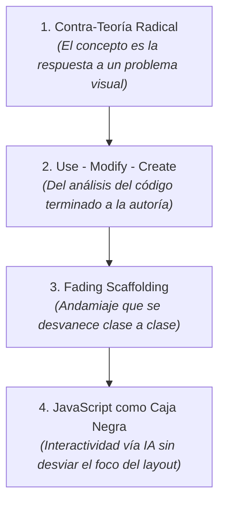
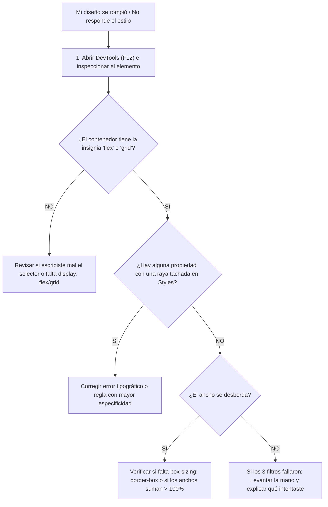

# Trayecto Anual de Diseño Web por Proyectos: Guía Metodológica

> **Una propuesta contra-teórica, práctica y orientada a interfaces reales para aprender a construir la web moderna desde cero absoluto.**

---

## 1. El Problema de la Enseñanza Tradicional

La mayoría de los cursos de desarrollo web tradicionales cometen dos errores fundamentales que frustran a los estudiantes adultos:

1. **La trampa enciclopédica:** Enseñar listas interminables de etiquetas HTML y propiedades CSS en abstracto, sin que el alumno entienda para qué sirven en una pantalla real.
2. **El salto al vacío sin andamiaje:** Explicar conceptos aislados durante 90 minutos y luego pedirle al estudiante: *"Ahora diseñá una página desde cero"*.

El resultado habitual es bloqueo cognitivo, dependencia crónica del docente y sensación de incapacidad frente a la "pantalla en blanco".

---

## 2. Los Cuatro Pilares del Método



### Pilar 1: Contra-Teoría Radical
**Los conceptos no se definen; se descubren resolviendo una fricción visual.**
* En lugar de dictar una clase teórica sobre `box-sizing: border-box`, el alumno agrega `padding: 20px` a una tarjeta de 300px y observa horrorizado cómo la tarjeta se ensancha a 340px y rompe la grilla. En ese instante de incomodidad visual se introduce `border-box`: como la solución técnica a un dolor tangible.
* No se explica `margin-top: auto` con diapositivas: se usa cuando los botones de tres tarjetas quedan bailando a diferentes alturas y se necesita clavarlos contra el piso del contenedor.

### Pilar 2: El Ciclo *Use - Modify - Create*
En cada sesión, el alumno transita tres fases cognitivas:
1. **USE (Usar / Observar):** El alumno abre un proyecto que ya funciona, lo inspecciona en el navegador y analiza qué hace cada bloque.
2. **MODIFY (Modificar guiado):** Sobre un *Starter Kit* con zonas protegidas, el alumno altera variables, modifica reglas y experimenta qué se rompe y qué se arregla.
3. **CREATE (Crear autónomo):** En el nivel desafío, el alumno extiende el componente agregando elementos nuevos, jerarquías visuales o interactividad.

### Pilar 3: Andamiaje Desvaneciente (*Fading Scaffolding*)
Al principio del trayecto, el Starter Kit viene con el 80% resuelto y el alumno interviene solo en el 20% crítico. A medida que avanzan las semanas, las zonas protegidas del sistema se reducen y la zona de trabajo del alumno se expande, hasta llegar al proyecto integrador final donde el alumno levanta la estructura completa.

### Pilar 4: JavaScript como "Caja Negra" Funcional
Aprender lógica de programación algorítmica mientras se intenta dominar el espacio bidimensional de CSS satura la memoria de trabajo. 
* En este trayecto **no se enseña programación en JavaScript**.
* La interactividad indispensable (abrir menús móviles, alternar facturación mensual/anual o cambiar a modo oscuro) se resuelve usando **prompts estructurados de IA provistos por la cátedra**.
* El alumno pega el script resultante como una **caja negra**, aprende a verificar que funcione en la consola del navegador y mantiene el 100% de su energía en maquetación, arquitectura semántica y estilos.

---

## 3. Anatomía de una Sesión de Clase (180 Minutos)

Cada clase de 3 horas reloj sigue una coreografía cronometrada y predecible:

| Bloque | Tiempo | Fase | ¿Qué ocurre en el aula? |
| :---: | :---: | :--- | :--- |
| **1** | `00:00 - 00:35` | **Apertura y Desarmado** | Demostración de la interfaz terminada en vivo. Inspección en pantalla gigante con DevTools (`F12`): el docente "desarma" las capas de la página mostrando los contenedores flex/grid y los desbordes. |
| **2** | `00:35 - 00:40` | **Entrega del Starter Kit** | Los alumnos clonan o descargan el proyecto. Identificación rápida de las marcas en el código: `/* ZONA DEL SISTEMA */` vs `/* TU CÓDIGO AQUÍ */`. |
| **3** | `00:40 - 02:25` | **Taller de Práctica Asistida** | Trabajo individual o en parejas sobre `INSTRUCCIONES.md`. El docente actúa como tutor de mesa, aplicando el protocolo estricto de debugging antes de responder preguntas. |
| **4** | `02:25 - 02:40` | **Pausa Técnica** | Descanso obligatorio. Desconexión de pantallas para reducir la fatiga visual. |
| **5** | `02:40 - 03:00` | **Standup Meeting de Cierre** | Ronda ágil de 20 minutos de pie o en círculo: qué componente se completó, qué propiedad o desborde generó bloqueo y cómo se destrabó el problema. |

---

## 4. El Protocolo Previo de Debugging

Para erradicar la costumbre de levantar la mano al primer error sin pensar, el alumno debe aplicar este algoritmo antes de consultar al equipo docente:



---

## 5. El Criterio de Corte entre Niveles

El trayecto se estructura en dos semestres de 16 clases cada uno, diferenciados por su **modelo mental**:

```text
┌────────────────────────────────────────────────────────────────────────┐
│ NIVEL 1: PÁGINAS WEB DE FLUJO CONTINUO (Clases 01 a 16)                │
│                                                                        │
│  • Modelo mental: Documento vertical de lectura y Scroll natural.       │
│  • Núcleo: HTML Semántico, Modelo de Caja estricto y Flexbox (1D).     │
│  • Producción: Despliegue sin terminal mediante Netlify Drop.          │
└────────────────────────────────────────────────────────────────────────┘
                                    │
                                    ▼
┌────────────────────────────────────────────────────────────────────────┐
│ NIVEL 2: INTERFACES DE APLICACIÓN Y DASHBOARDS (Clases 17 a 32)        │
│                                                                        │
│  • Modelo mental: Cabina de control / Pantalla de app (100vh fijo).    │
│  • Núcleo: Git/GitHub, Posicionamiento (capas), CSS Grid (2D) y Tokens.│
│  • Producción: Despliegue automatizado continuo con GitHub Pages.      │
└────────────────────────────────────────────────────────────────────────┘
```

> 📄 **Consultá la planificación completa clase por clase:**  
> En el documento [**`PROGRAMA.md`**](PROGRAMA.md) se encuentra el desglose exhaustivo de las 32 interfaces a construir, con sus problemas visuales asociados, conceptos técnicos involucrados, arquetipos recomendados y scripts de IA.

---

## 6. Diseño Anti-Cliché: El Catálogo de Arquetipos

Para evitar que los trabajos de los alumnos se vean como "páginas genéricas hechas por una IA" (bordes inflados de 30px, gradientes violetas y textos lavados ilegibles), el método incorpora un catálogo de **4 Arquetipos Visuales**:

1. **SaaS Moderno (Clean Tech):** Paleta Slate con acento Índigo, radios moderados (8px), sombras compuestas y micro-interacciones de producto digital.
2. **Editorial Cálido (Humanista):** Paleta Stone con acento Terracota, tipografía Serif elegante (*Playfair Display*), radios rectilíneos (0-4px) y cero sombras (profundidad por contraste de línea).
3. **Neo-Brutalismo Suave (Pop/Dinámico):** Trazos negros sólidos de 2px, sombras angulares duras con offset puro (`4px 4px 0 #000`), fondos pasteles vibrantes y gran personalidad.
4. **Industrial / Fintech (Alta Densidad):** Modo oscuro profundo (`#09090b`), datos numéricos con fuentes monoespaciadas (*JetBrains Mono*), acentos verde terminal y estética de cabina de control.

---

## 7. Filosofía del Standup de Cierre

Los últimos 20 minutos de cada clase no son para que el docente hable, sino para consolidar el **modelo mental** de los alumnos. Se realizan dos preguntas disparadoras:

1. **La Pregunta Diagnóstica:** Evalúa si el alumno entendió *por qué* funciona la solución técnica (ej: *"¿Por qué `margin-top: auto` solo empuja al botón si el padre es Flexbox vertical?"*).
2. **La Pregunta de Debugging:** Comparte el aprendizaje del error con el grupo (ej: *"¿A quién se le desbordó la grilla al agrandar la tarjeta central y cómo lo solucionó sin romper a las vecinas?"*).

Este cierre transforma el error individual en un activo pedagógico colectivo, preparando al estudiante para la dinámica real de los equipos de tecnología.
