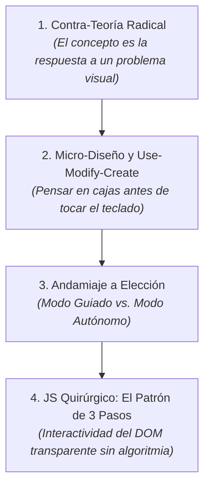
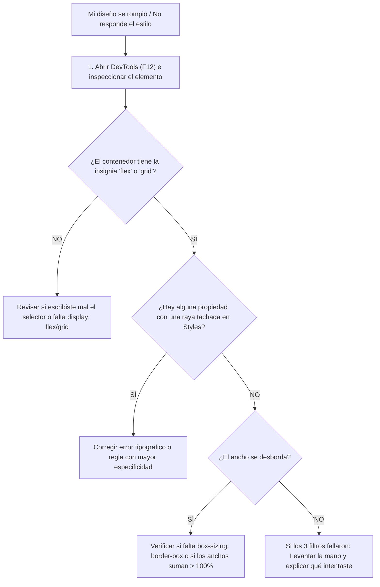

# Trayecto Anual de Diseño Web por Proyectos: Guía Metodológica

> **Una propuesta contra-teórica, práctica y orientada a interfaces reales para aprender a construir la web moderna desde cero absoluto.**

---

## 1. El Problema de la Enseñanza Tradicional

La mayoría de los cursos de desarrollo web tradicionales cometen dos errores fundamentales que frustran a los estudiantes adultos:

1. **La trampa enciclopédica:** Enseñar listas interminables de etiquetas HTML y propiedades CSS en abstracto, sin que el alumno entienda para qué sirven en una pantalla real.
2. **El salto al vacío sin andamiaje:** Explicar conceptos aislados durante 90 minutos y luego pedirle al estudiante: *"Ahora diseñá una página desde cero"*.

El resultado habitual es bloqueo cognitivo, dependencia crónica del docente y sensación de incapacidad frente a la "pantalla en blanco".

---

## 2. Los Cuatro Pilares del Método



### Pilar 1: Contra-Teoría Radical
**Los conceptos no se definen; se descubren resolviendo una fricción visual.**
* En lugar de dictar una clase teórica sobre `box-sizing: border-box`, el alumno agrega `padding: 20px` a una tarjeta de 300px y observa cómo la tarjeta se ensancha a 340px y rompe la grilla. En ese instante de incomodidad visual se introduce `border-box`: como la solución técnica a un dolor tangible.
* No se explica `margin-top: auto` con diapositivas: se usa cuando los botones de tres tarjetas quedan bailando a diferentes alturas y se necesita clavarlos contra el piso del contenedor.

### Pilar 2: Micro-Diseño Previo y Ciclo *Use - Modify - Create*
Antes de escribir una sola línea de código, el alumno aprende a **pensar en cajas** mediante un boceto de 5 minutos:
* **Herramientas recomendadas:** [Excalidraw](https://excalidraw.com) o [tldraw](https://tldraw.com) (digitales, gratuitas, abren en el navegador sin login) o papel y lápiz con cronómetro estricto.
* **Prevención de la trampa del dibujo:** Queda prohibido "ilustrar" o dibujar detalles artísticos. El ejercicio consiste exclusivamente en dibujar **cajas rectangulares anidadas** (caja padre y cajas hijas). *"Si no podés dibujarlo como cajas en 3 minutos, no lo vas a poder maquetar en CSS"*.
* **El ciclo en el código:**
  1. **USE (Usar / Observar):** Analizar la interfaz terminada con DevTools.
  2. **MODIFY (Modificar guiado):** Alterar variables, propiedades y espaciados sobre el código base.
  3. **CREATE (Crear autónomo):** Extender la interfaz con nuevos componentes o estados.

### Pilar 3: Andamiaje a Elección (*Choose Your Scaffold*)
Para respetar los distintos ritmos de aprendizaje de los adultos sin generar falsa sensación de competencia ni frustración, cada clase ofrece dos modalidades de trabajo:
* **Modo Guiado (Con Andamiaje):** Para quienes necesitan red de contención. Incluye el Starter Kit con la estructura HTML resuelta y zonas de trabajo delimitadas mediante comentarios.
* **Modo Autónomo (Sin Andamiaje):** Para quienes eligen desafiarse. Incluye únicamente un archivo `contenido.txt` con los textos crudos y la captura visual de referencia. El alumno abre un archivo vacío, genera su HTML semántico con Emmet (`!`) y escribe sus hojas de estilo desde cero.

### Pilar 4: JavaScript Quirúrgico (El Patrón de los 3 Pasos)
En lugar de una "caja negra" mágica que el alumno copia a ciegas y no sabe reparar si falla, o de un curso pesado de algoritmia que devora semanas, se enseña **JavaScript orientado a eventos del DOM**, basado en un único patrón transparente:

```javascript
// 1. AGARRAR el elemento de la pantalla
const toggleBtn = document.querySelector('.navbar-toggle');
const menu = document.querySelector('.navbar-menu');

// 2. ESCUCHAR el clic del usuario
toggleBtn.addEventListener('click', () => {
  // 3. PRENDER / APAGAR una clase de CSS
  menu.classList.toggle('is-open');
});
```

* **Por qué funciona:** Con estas 3 líneas se resuelve el 95% de la interactividad del maquetador (menús hamburguesa, modales, pestañas, acordeones y alternadores de modo oscuro).
* **Autonomía de debugging:** Si un botón no responde, el alumno sabe abrir la consola, revisar si el selector del `querySelector` coincide con su HTML y corregirlo en 30 segundos sin depender de la IA. La IA queda reservada únicamente para utilidades secundarias (ej. persistencia en `localStorage` o cálculos de precios).

---

## 3. Anatomía de una Sesión de Clase (180 Minutos)

Cada clase de 3 horas reloj sigue una coreografía cronometrada y predecible:

| Bloque | Tiempo | Fase | ¿Qué ocurre en el aula? |
| :---: | :---: | :--- | :--- |
| **1** | `00:00 - 00:35` | **Apertura y Desarmado** | Demostración de interfaz terminada. Diagramación rápida de cajas en Excalidraw (5 min) + inspección de estilos en DevTools (`F12`). |
| **2** | `00:35 - 00:40` | **Elección de Modalidad** | El alumno elige si descargará el Starter Kit en **Modo Guiado** o el reto en **Modo Autónomo**. |
| **3** | `00:40 - 02:25` | **Taller de Práctica Asistida** | Trabajo individual o en parejas sobre `INSTRUCCIONES.md`. El docente actúa como tutor de mesa aplicando el protocolo de debugging previo a consultas. |
| **4** | `02:25 - 02:40` | **Pausa Técnica** | Descanso obligatorio. Desconexión de pantallas para reducir la fatiga visual. |
| **5** | `02:40 - 03:00` | **Standup Meeting de Cierre** | Ronda ágil de 20 minutos: qué componente se completó, qué propiedad o desborde generó bloqueo y cómo se resolvió. |

---

## 4. El Protocolo Previo de Debugging

Para erradicar la costumbre de levantar la mano al primer error sin pensar, el alumno debe aplicar este algoritmo antes de consultar al equipo docente:



---

## 5. El Criterio de Corte entre Niveles

El trayecto se estructura en dos semestres de 16 clases cada uno, diferenciados por su **modelo mental**:

```text
┌────────────────────────────────────────────────────────────────────────┐
│ NIVEL 1: PÁGINAS WEB DE FLUJO CONTINUO (Clases 01 a 16)                │
│                                                                        │
│  • Modelo mental: Documento vertical de lectura y Scroll natural.       │
│  • Núcleo: HTML Semántico, Modelo de Caja estricto y Flexbox (1D).     │
│  • Interactividad: Patrón de 3 pasos JS para menús y acordeones.       │
│  • Producción: Despliegue sin terminal mediante Netlify Drop.          │
└────────────────────────────────────────────────────────────────────────┘
                                    │
                                    ▼
┌────────────────────────────────────────────────────────────────────────┐
│ NIVEL 2: INTERFACES DE APLICACIÓN Y DASHBOARDS (Clases 17 a 32)        │
│                                                                        │
│  • Modelo mental: Cabina de control / Pantalla de app fija (100dvh).   │
│  • Núcleo: Git/GitHub, Posicionamiento (capas), CSS Grid (2D) y Tokens.│
│  • Regla de Viewport: Mobile-Scroll (natural) y Desktop-App (100dvh).  │
│  • Salvaguarda Grid: min-width: 0 en columnas para evitar desbordes.   │
│  • Producción: Despliegue automatizado continuo con GitHub Pages.      │
└────────────────────────────────────────────────────────────────────────┘
```

> 📄 **Consultá la planificación completa clase por clase:**  
> En el documento [**`PROGRAMA.md`**](PROGRAMA.md) se encuentra el desglose exhaustivo de las 32 interfaces a construir, con sus problemas visuales asociados, conceptos técnicos involucrados, arquetipos recomendados y scripts de IA.

---

## 6. Práctica Semanal Autónoma

Para mitigar la brecha de 6 días entre clase y clase sin caer en imposiciones escolares ni recordatorios invasivos que suelen ignorarse:
* Cada clase incluye en su repositorio un **Reto Asincrónico Opcional** de 20 a 30 minutos.
* Se enfoca en una micro-tarea concreta: agregar un componente complementario al proyecto terminado en clase o resolver un mini-ejercicio de detección de errores (*"Spot the Bug"*).
* La realización es 100% autogestionada por el alumno adulto.

---

## 7. Manejo Profesional del Viewport en Nivel 2

Para erradicar la frustración habitual de las pantallas de aplicación en dispositivos móviles:
1. **Uso de `100dvh` en lugar de `100vh`:** Adopción de la unidad moderna *Dynamic Viewport Height* para evitar que la barra de direcciones de Safari o Chrome en smartphones corte la interfaz.
2. **Estrategia *Mobile-Scroll / Desktop-App*:** En celulares, la aplicación se comporta como un documento de scroll continuo vertical. La cabina cerrada (`height: 100dvh; overflow: hidden;`) con paneles independientes de scroll solo se activa en pantallas de escritorio mediante `@media (min-width: 1024px)`.
3. **Escudo protector en Grid:** Regla universal de `min-width: 0;` en toda celda o columna de CSS Grid para neutralizar el desborde horizontal de textos largos o tablas.

---

## 8. Diseño Anti-Cliché: El Catálogo de Arquetipos

Para evitar que los proyectos se vean como plantillas genéricas de IA (radios desmedidos de 30px, gradientes saturados sin sentido y bajo contraste), se adopta el catálogo de **4 Arquetipos Visuales** de la [Skill Frontend Standards](.agents/skills/frontend-standards/SKILL.md):

1. **SaaS Moderno (Clean Tech):** Paleta Slate con acento Índigo, radios de 6 a 8px, doble sombra compuesta y micro-interacciones de software.
2. **Editorial Cálido (Humanista):** Paleta Stone con acento Terracota, tipografía Serif elegante (*Playfair Display*), radios rectilíneos y cero sombras.
3. **Neo-Brutalismo Suave (Pop/Dinámico):** Trazos negros sólidos de 2px, sombras angulares duras con offset puro (`4px 4px 0 #000`) y fondos pasteles contrastados.
4. **Industrial / Fintech (Alta Densidad):** Modo oscuro grafito (`#09090b`), cifras numéricas monoespaciadas (*JetBrains Mono*), acentos verde terminal y precisión técnica.

---

## 9. Filosofía del Standup de Cierre

Los últimos 20 minutos de cada clase consolidan el **modelo mental** de los alumnos mediante dos preguntas disparadoras:

1. **La Pregunta Diagnóstica:** Evalúa la comprensión del *por qué* (ej: *"¿Por qué `margin-top: auto` solo empuja el botón al fondo si la tarjeta es un Flexbox de columna?"*).
2. **La Pregunta de Debugging:** Comparte el aprendizaje del error con el grupo (ej: *"¿A quién se le desbordó la grilla al agrandar la tarjeta central y qué propiedad lo resolvió?"*).
