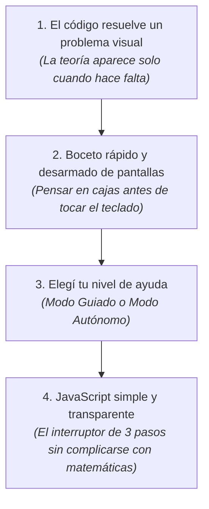
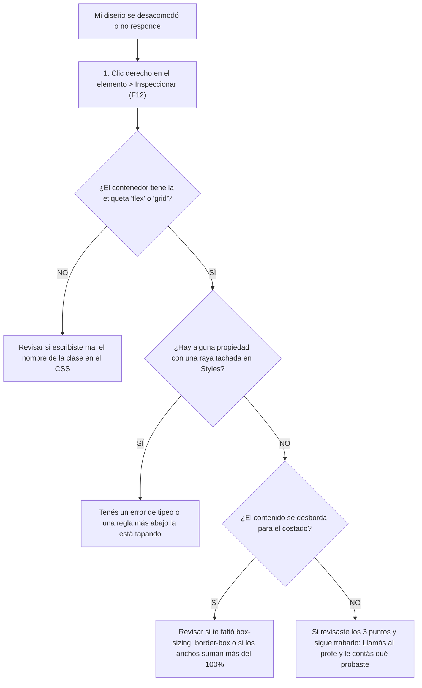

# Cómo enseñamos y aprendemos: Nuestra Propuesta de Trabajo

> **Un recorrido 100% práctico, basado en proyectos reales y pensado para aprender a diseñar y construir la web moderna desde cero absoluto.**

---

## 1. Por qué los cursos tradicionales suelen frustrar a quienes arrancan de cero

La mayoría de los cursos de programación y diseño web cometen dos errores comunes que generan abandono y bloqueo:

1. **Aprender etiquetas de memoria no sirve para diseñar:** Estudiar de memoria listas de 40 etiquetas HTML o propiedades de CSS en abstracto aburre y desmotiva. Saber qué significa una etiqueta en un apunte teórico no te enseña a resolver por qué dos botones quedan desalineados en una pantalla real.
2. **El bloqueo frente a la hoja en blanco:** Explicar conceptos aislados durante horas y después decirle al alumno *"ahora hacé una página web completa desde cero"* paraliza. Sin un método que te acompañe paso a paso, no sabés por dónde arrancar.

---

## 2. Los cuatro principios de nuestras clases



### Principio 1: El código es la respuesta a un problema visual
**Acá no memorizamos definiciones; descubrimos las herramientas cuando las necesitamos.**
* No te damos una clase teórica sobre `box-sizing: border-box`. Primero le agregás espacio interior (`padding: 20px`) a una tarjeta y ves con tus propios ojos cómo se ensancha de más y se rompe la grilla. En ese momento exacto descubrimos la regla que lo soluciona.
* No explicamos `margin-top: auto` con diapositivas: lo usamos cuando los botones de tres tarjetas quedan bailando a distintas alturas y necesitamos que queden todos clavados en la misma línea al fondo.

### Principio 2: Boceto rápido y desarmado de pantallas
Antes de escribir código en el teclado, aprendemos a **pensar en cajas organizadas**:
* **Herramientas ágiles:** Usamos herramientas online gratuitas y sin registro como [Excalidraw](https://excalidraw.com) o [tldraw](https://tldraw.com) (o papel y lápiz con un límite estricto de 5 minutos).
* **Prohibido el dibujo artístico:** No perdemos tiempo ilustrando detalles ni sombras a mano. El ejercicio es únicamente dibujar rectángulos anidados (cajas padre y cajas hijas). *"Si podés dibujarlo como cajas ordenadas en 3 minutos, lo podés maquetar en código sin problemas"*.
* **El camino de trabajo:**
  1. **Mirar y desarmar:** Abrimos la pantalla terminada con el inspector del navegador (DevTools) para ver qué hay detrás de escena.
  2. **Modificar:** Cambiamos valores, colores y medidas para entender qué pasa cuando tocamos cada cosa.
  3. **Crear:** Agregamos secciones nuevas, tarjetas o componentes con nuestro propio criterio.

### Principio 3: Elegí tu nivel de ayuda en cada clase
Cada persona tiene su propio ritmo y no todos los días estamos igual. Por eso, en cada clase vos elegís cómo querés trabajar:
* **Modo Guiado (Con plantilla asistida):** Si querés avanzar seguro y con red de contención. Descargás una carpeta que ya tiene el HTML escrito y comentarios claros en el CSS que te dicen exactamente en qué renglones escribir tu código.
* **Modo Autónomo (Desde la hoja en blanco):** Si querés ponerte a prueba y volar solo. Te damos únicamente un archivo con los textos crudos y la imagen de diseño terminada para que abras un archivo vacío y construyas todo desde cero.

### Principio 4: JavaScript simple y transparente (El interruptor de 3 pasos)
Para darle movimiento a la web (abrir un menú en celulares, alternar un modo oscuro o mostrar una ventana modal) no hace falta estudiar meses de programación compleja, variables matemáticas ni bucles.

Usamos un patrón de **3 pasos claros** que funciona exactamente como un interruptor de luz:

```javascript
// 1. ELEGIR el elemento de la pantalla
const botonMenu = document.querySelector('.menu-toggle');
const menu = document.querySelector('.navbar-links');

// 2. ESCUCHAR el clic del usuario
botonMenu.addEventListener('click', () => {
  // 3. PRENDER / APAGAR una clase de estilos en CSS
  menu.classList.toggle('is-open');
});
```

* **Por qué funciona:** Con este patrón resolvés el 95% de la interactividad de cualquier sitio web moderno conectando el clic del usuario con los estilos que ya sabés hacer en CSS.
* **Si algo falla, sabés cómo arreglarlo:** Si el menú no abre, abrís la consola del navegador, revisás si el nombre del botón coincide con el que pusiste en el HTML y lo corregís en 30 segundos, sin depender de que una inteligencia artificial te adivine el código.

---

## 3. Cómo es una clase de 3 horas (Paso a paso)

Cada sesión de 180 minutos sigue una rutina clara y predecible:

| Bloque | Tiempo | Momento | Qué hacemos en el aula |
| :---: | :---: | :--- | :--- |
| **1** | `00:00 - 00:35` | **Apertura y Desarmado** | Proyectamos y desarmamos la **`version-terminada`** en vivo con DevTools (`F12`). Boceto rápido de cajas en Excalidraw (5 min). |
| **2** | `00:35 - 00:40` | **Elección de Modo** | Cada uno elige su carpeta de trabajo: **`starter-kit-guiado`** (con plantilla) o **`starter-kit-autonomo`** (hoja en blanco). |
| **3** | `00:40 - 02:25` | **Taller de Práctica** | Trabajo individual o en duplas sobre la guía `INSTRUCCIONES.md`. El docente recorre mesa por mesa ayudando a destrabar bloqueos. |
| **4** | `02:25 - 02:40` | **Pausa** | Descanso para despejar la vista, tomar un café y desconectar de la pantalla. |
| **5** | `02:40 - 03:00` | **Puesta en Común y Cierre** | Charla en ronda de 20 minutos: qué logró completar cada uno, qué propiedad se resistió y cómo encontramos la solución. |

### La estructura de carpetas que acompaña cada clase:

```text
clase-XX/
├── FICHA-TECNICA.md            # Ficha pedagógica de la sesión para el docente y el alumno
├── INSTRUCCIONES.md            # Guía paso a paso: Nivel Base, Desafío, Reto semanal y Biblioteca MDN
├── version-terminada/          # La meta visual 100% resuelta para desarmar y comparar en paralelo
├── starter-kit-guiado/          # Plantilla con HTML listo y comentarios que indican dónde escribir
└── starter-kit-autonomo/        # Texto crudo y especificación para maquetar desde cero
```

---

## 4. Qué hacer cuando algo no se ve como querés (Protocolo de ayuda)

Antes de levantar la mano frustrado, te acostumbramos a usar el inspector del navegador con este caminito de 4 pasos que usan los profesionales todos los días:



---

## 5. El camino en dos niveles

El año se organiza en dos semestres independientes y continuos:

```text
┌────────────────────────────────────────────────────────────────────────┐
│ NIVEL 1: PÁGINAS WEB Y SITIOS DE LECTURA (Clases 01 a 16)              │
│                                                                        │
│  • La idea central: Páginas que se leen hacia abajo con scroll natural. │
│  • Herramientas clave: HTML ordenado, Modelo de Caja y Flexbox.         │
│  • Interactividad: El patrón de 3 pasos para menús y desplegables.     │
│  • Publicación: Tu sitio publicado gratis en internet con Netlify Drop.│
└────────────────────────────────────────────────────────────────────────┘
                                    │
                                    ▼
┌────────────────────────────────────────────────────────────────────────┐
│ NIVEL 2: APLICACIONES, PANELES Y SISTEMAS DE DISEÑO (Clases 17 a 32)   │
│                                                                        │
│  • La idea central: Pantallas de app interactivas (tipo Spotify/Gmail). │
│  • Herramientas clave: Git y GitHub, CSS Grid en 2D y Variables CSS.   │
│  • Para celulares y computadoras: Scroll continuo en móviles y pantalla│
│    fija moderna (100dvh) en computadoras.                              │
│  • Publicación: Actualización automática en internet con GitHub Pages. │
└────────────────────────────────────────────────────────────────────────┘
```

> 📄 **Consultá el temario completo clase por clase:**  
> En el documento [**`PROGRAMA.md`**](PROGRAMA.md) podés ver el detalle de los 32 proyectos que vamos a construir a lo largo del año.

---

## 6. Política de Entrega Semanal por Releases (GitHub)

Para cuidar la progresión pedagógica y el valor del aula:
* Todos los proyectos y commits se van desarrollando en el repositorio.
* La clase oficial de la semana se fija y publica desde la interfaz web de GitHub mediante el sistema de **Releases** (*Latest Release*), permitiendo a los alumnos acceder a la versión oficial correspondiente a su semana de cursada sin perderse en código futuro.
* Los pasos operativos para el docente se detallan en [**`GUIA-DOCENTE-RELEASES.md`**](GUIA-DOCENTE-RELEASES.md).

---

## 7. Práctica opcional para la semana

Sabemos que los adultos tienen trabajos, familias y poco tiempo libre. Por eso:
* **No hay tareas escolares obligatorias ni fechas de entrega que te persigan.**
* Cada proyecto incluye un **Reto Opcional** de 20 minutos al final de la guía para que, si tenés un rato libre durante la semana, puedas agregarle una tarjeta nueva a tu diseño o resolver un mini-ejercicio para fijar lo que vimos.
* Cada uno administra su tiempo con libertad.

---

## 7. Diseños con personalidad propia (Arquetipos Visuales)

Para que tus proyectos no se vean como plantillas genéricas de internet con bordes gigantes inflados y colores lavados, en el curso trabajamos con 4 estilos visuales profesionales que podés elegir:

1. **SaaS Moderno (Tecnología Limpia):** Fondos claros y nítidos con acento azul o índigo, bordes redondeados sutiles y tarjetas bien definidas. Ideal para productos digitales y tablas de precios.
2. **Editorial Cálido (Contenido y Lectura):** Fondos arena suaves, acentos terracota y tipografías con remates elegantes. Ideal para recetas, blogs, cultura y portfolios de autor.
3. **Neo-Brutalismo Suave (Creativo y Dinámico):** Trazos negros sólidos, sombras duras sin difuminar y fondos con personalidad. Ideal para diseño independiente y eventos.
4. **Industrial / Fintech (Control y Modo Oscuro):** Fondos oscuros de grafito, números claros con tipografía técnica y acentos verdes. Ideal para paneles de métricas y consolas.

---

## 8. El cierre de cada clase: aprender de los errores de todos

Los últimos 20 minutos de clase no son para que el docente hable, sino para hacer una ronda rápida en grupo:
* **¿Qué componente lograste terminar hoy?**
* **¿Qué propiedad o desborde te dio dolor de cabeza y cómo lo solucionaste?**

Compartir el problema en voz alta le ahorra tiempo a tus compañeros y consolida tu propio aprendizaje, acostumbrándote a la forma real en la que trabajan los equipos de tecnología.
