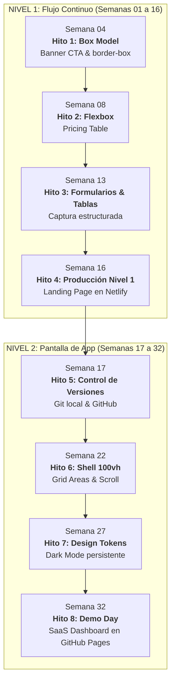

# Programa y Malla Curricular: 32 Clases por Proyectos

> **Trayecto Anual de Diseño Web por Proyectos (Nivel 1 y Nivel 2)**  
> 32 semanas · 1 clase semanal de 3 horas reloj (180 min) · Cero teoría abstracta · Fricciones visuales reales

---

## Índice General

1. [Estructura y Reglas de la Malla](#1-estructura-y-reglas-de-la-malla)
2. [Nivel 1: Páginas Web e Interfaces de Flujo Continuo (Clases 01 a 16)](#2-nivel-1-páginas-web-e-interfaces-de-flujo-continuo-clases-01-a-16)
3. [Nivel 2: Interfaces de Aplicación, Dashboards y Sistemas de Diseño (Clases 17 a 32)](#3-nivel-2-interfaces-de-aplicación-dashboards-y-sistemas-de-diseño-clases-17-a-32)
4. [Matriz de Hitos y Entregables](#4-matriz-de-hitos-y-entregables)

---

## 1. Estructura y Reglas de la Malla

Cada clase está estructurada en torno a una **interfaz real** y una **fricción técnica** que motiva el aprendizaje. Los estudiantes nunca aprenden etiquetas o propiedades aisladas; siempre responden a una necesidad de diseño concreta.

* **Arquetipos Visuales:** Cada clase propone un arquetipo visual de referencia (según la [Skill Frontend Standards](.agents/skills/frontend-standards/SKILL.md)) para garantizar variedad estética y profesionalismo.
* **Caja Negra de IA:** Solo se introduce script de IA cuando la interfaz exige interactividad indispensable (menús móviles, alternadores, modales), sin distraer del foco de maquetación.
* **Metodología pedagógica completa:** Consultar [METODOLOGIA.md](METODOLOGIA.md).

---

## 2. Nivel 1: Páginas Web e Interfaces de Flujo Continuo (Clases 01 a 16)

> **Modelo mental:** Documento y flujo de lectura vertical con scroll.  
> **Infraestructura:** Visual Studio Code + Live Server + Despliegue en producción con **Netlify Drop**.

| # | Proyecto / Interfaz | Fricción Visual y Problema Real | Núcleo Técnico HTML5 / CSS3 | Arquetipo Sugerido | Caja Negra IA |
|---|---|---|---|---|:---:|
| **01** | **Tarjeta de Perfil Personal (Link in Bio)** | La web por defecto es texto negro plano sobre fondo blanco con márgenes toscos. | Estructura básica (`<!DOCTYPE>`, `<html>`, `<head>`, `<body>`), enlaces `<a>`, imágenes `` con `alt`. Estilos en línea vs archivo `style.css` inicial. | Neo-Brutalismo Suave | No |
| **02** | **Ficha de Receta Culinaria** | El texto corrido sin jerarquías ni estructura semántica cansa la vista y es inaccesible. | Semántica: `<header>`, `<main>`, `<article>`, `<section>`, listas `<ul>`/`<ol>`. Tipografía base: `font-family`, `font-size`, `line-height`, `color`. | Editorial Cálido | No |
| **03** | **Tarjeta de Producto E-Commerce** | Los textos e imágenes se pegan a los bordes de la caja y se desbordan sin control. | **Box Model I:** `width`, `height`, `padding`, `border`, `margin`. Colapso de márgenes verticales y desbordes con `overflow`. | SaaS Moderno | No |
| **04** | **Banner Promocional / Call to Action** | Al agregar `padding`, la tarjeta se ensancha más de lo definido y rompe el contenedor. | **Box Model II:** `box-sizing: border-box`, reseteo universal `*`, fondos (`background-color`, `background-image`, `background-size: cover`). | Neo-Brutalismo Suave | No |
| **05** | **Artículo Editorial con Citas Destacadas** | Los párrafos tienen líneas kilométricas ilegibles en monitores anchos y fuentes del sistema anticuadas. | Tipografía web con Google Fonts (`<link>`), escala en `rem`, `letter-spacing`, centrado horizontal con `max-width` en `rem` y `margin: 0 auto`. | Editorial Cálido | No |
| **06** | **Barra de Navegación Simple (Topbar)** | Los enlaces (`<a>`) se ponen en línea pero no se pueden alinear ni separar limpiamente con `float` o `inline-block`. | **Flexbox I:** `display: flex`, dirección de flujo (`flex-direction: row`), distribución con `justify-content` (`space-between`, `center`). | SaaS Moderno | No |
| **07** | **Barra de Herramientas y Acciones** | Los iconos y los textos dentro del mismo botón quedan desalineados verticalmente. | **Flexbox II:** Alineación transversal con `align-items: center`, propiedad `gap` para espaciado limpio entre ítems, estados `:hover` y `:active`. | Industrial / Fintech | No |
| **08** | **Grilla de Precios (Pricing Table)** | Tres tarjetas que se apilan solas; al ponerlas en fila tienen alturas desparejas y los botones flotan a distinta altura. | **Flexbox III:** `flex: 1` para anchos equitativos, `align-items: stretch` para igualar alturas, flex vertical interno en cada tarjeta y `margin-top: auto` en el botón. | SaaS Moderno | Sí (Switch Mensual/Anual) |
| **09** | **Showcase / Galería de Trabajos** | Al achicar la pantalla, las tarjetas en fila se aplastan infinitamente o se salen de la pantalla horizontalmente. | **Flexbox IV:** `flex-wrap: wrap`, anchos responsivos básicos con porcentajes (`%`) y `min-width`, cálculo de columnas flexibles. | Neo-Brutalismo Suave | No |
| **10** | **Catálogo de Productos con Filtros** | Necesidad de combinar una columna fija de filtros a la izquierda y una grilla fluida a la derecha. | Flexbox anidado: contenedor maestro fila (`sidebar` + `main`) con grilla interna multilínea. | SaaS Moderno | No |
| **11** | **Formulario de Registro / Newsletter** | Los campos de entrada quedan desalineados, no se sabe dónde escribir y no tienen foco visual. | `<form>`, `<input>` (`text`, `email`, `password`), vinculación estricta de `<label for="...">` con `<input id="...">`, estados `:focus-visible`. | SaaS Moderno | No |
| **12** | **Formulario de Cotización Complejo** | Casillas de verificación, opciones únicas y áreas de texto desordenadas sin agrupación lógica. | `<select>`, `<textarea>`, `<fieldset>`, `<legend>`, `<input type="checkbox">` y `type="radio"`. Maquetación accesible de formularios con Flexbox. | Editorial Cálido | No |
| **13** | **Tabla de Posiciones / Comparativa** | Los datos tabulares armados con `divs` no se alinean verticalmente ni comunican semántica de datos. | `<table>`, `<thead>`, `<tbody>`, `<tr>`, `<th>`, `<td>`. Fricciones: `border-collapse: collapse`, padding de celdas, alineación numérica a la derecha. | Industrial / Fintech | No |
| **14** | **Landing Page de Presentación (Parte 1: Maquetación)** | Integrar todas las piezas aprendidas (Navbar, Hero, Features, Pricing, Footer) en un documento semántico cohesivo. | Ensamblado semántico integral de Nivel 1. Jerarquía de encabezados (`h1` a `h3`), anclajes de scroll (`id` y `href="#..."`), acordeón nativo con `
` y `
`. | A elección del alumno | No |
| **15** | **Landing Page de Presentación (Parte 2: Pulido e Interactividad)** | La barra de navegación se desborda en pantallas angostas y se necesita un menú desplegable interactivo. | Meta viewport (`<meta name="viewport">`), media queries introductorias, favicon y metadatos básicos. Incorporación de script IA de caja negra para menú hamburguesa. | A elección del alumno | Sí (Menú móvil accesible) |
| **16** | **Despliegue y Auditoría de Nivel 1** | El proyecto solo existe en la máquina local del alumno y tiene posibles errores de sintaxis o bajo contraste. | Auditoría de código: W3C Validator, auditoría de Accesibilidad/Performance con Chrome DevTools (Lighthouse). Despliegue en producción con **Netlify Drop**. Demo day de cierre de Nivel 1. | Libre | No |

---

## 3. Nivel 2: Interfaces de Aplicación, Dashboards y Sistemas de Diseño (Clases 17 a 32)

> **Modelo mental:** Cabina de control / Pantalla de aplicación (*Viewport App*, 100vh fijo, áreas independientes de scroll).  
> **Infraestructura:** Terminal de VS Code + Control de versiones con **Git local** + Repositorios remotos y despliegue automatizado con **GitHub Pages**.

| # | Proyecto / Interfaz | Fricción Visual y Problema Real | Núcleo Técnico HTML5 / CSS3 / Herramientas | Arquetipo Sugerido | Caja Negra IA |
|---|---|---|---|---|:---:|
| **17** | **Setup Profesional: Tarjeta de Métricas Versionada** | Modificar código sin historial provoca pérdida irreparable de trabajo ante errores o roturas. | Inicialización de Git local (`git init`, `add`, `commit`), creación de repositorio remoto en GitHub, sincronización con `git push`. Estructura modular de carpetas. | Industrial / Fintech | No |
| **18** | **Tarjeta con Badge Notificador y Menú de Acciones** | Se necesita clavar una pastilla ("Nuevo", "3") en la esquina superior exacta de una tarjeta sin que empuje el contenido. | **Posicionamiento I:** Flujo normal vs posicionamiento fuera de flujo. `position: relative` (padre como ancla) y `position: absolute` (hijo posicionado con `top`/`right`). | SaaS Moderno | No |
| **19** | **Header Sticky con Dropdown de Notificaciones** | El encabezado desaparece al scrollear y un menú flotante queda tapado por los elementos de abajo. | **Posicionamiento II:** `position: sticky` vs `fixed`. Contexto de apilamiento y manejo de capas de profundidad con `z-index`. | Industrial / Fintech | Sí (Dropdown accesible) |
| **20** | **Galería Fotográfica / Portfolio Asimétrico** | Flexbox obliga a pensar fila por fila; no permite controlar simultáneamente filas y columnas para armar huecos y mosaicos. | **CSS Grid I:** Introducción al motor bidimensional. `display: grid`, `grid-template-columns`, `grid-template-rows`, unidad de fracción `fr` y propiedad `gap`. | Neo-Brutalismo Suave | No |
| **21** | **Bento Grid de Funcionalidades (Estilo Apple / Linear)** | Diseñar tarjetas donde una ocupa 2 columnas y 2 filas mientras otras son cuadradas pequeñas sin romper la grilla. | **CSS Grid II:** Expansión de celdas con `grid-column: span ...` y `grid-row: span ...`. Posicionamiento explícito por líneas de grilla (`1 / 3`). | SaaS Moderno | No |
| **22** | **Layout Shell de Aplicación (Sidebar + Topbar + Main)** | Queremos una pantalla de app fija (sin scroll en la ventana global) donde solo scrollee el panel central de contenido. | **CSS Grid III:** `grid-template-areas` con nombres semánticos (`"sidebar header" "sidebar main"`). Fijación de alto total con `100vh` y scroll interno independiente con `overflow-y: auto`. | Industrial / Fintech | No |
| **23** | **Dashboard de Métricas (Macro Grid + Micro Flexbox)** | Dificultad para coordinar la estructura general de la pantalla con la alineación fina dentro de cada tarjeta. | **La Regla de Oro Integrada:** CSS Grid para el esqueleto macro de la aplicación y Flexbox para los componentes micro internos (iconos, cifras, badges de tendencia). | Industrial / Fintech | No |
| **24** | **Grilla Adaptable sin Media Queries** | Escribir decenas de media queries para cada ancho de pantalla genera código frágil y engorroso. | **CSS Grid IV:** Funciones avanzadas de fluidez automática: `repeat()`, `minmax()`, `auto-fit` y `auto-fill`. Grilla que se adapta a cualquier pantalla sin una sola media query. | SaaS Moderno | No |
| **25** | **Dashboard Mobile-First y Menú Lateral de App** | El layout de escritorio colapsa en celulares: la sidebar ocupa toda la pantalla y no deja ver el contenido. | Estrategia **Mobile-First**: estilos base para pantallas chicas y media queries con `@media (min-width: 768px)`. Script de IA para abrir/cerrar la sidebar en pantallas móviles. | SaaS Moderno | Sí (Sidebar móvil deslizable) |
| **26** | **Sistema de Tokens de Diseño (Design System)** | Cambiar un color de marca o un radio implica buscar y reemplazar valores manuales en cientos de líneas de CSS. | **Variables CSS (Custom Properties):** Declaración en `:root`, cascada y alcance léxico, tokens de color, espaciado, radios de borde y elevaciones. | Libre | No |
| **27** | **Dashboard con Modo Oscuro (Theming Dinámico)** | Los usuarios demandan modo oscuro, pero duplicar la hoja de estilos crea un infierno de mantenimiento. | Theming moderno redefiniendo variables CSS bajo `[data-theme="dark"]` y detección automática con `@media (prefers-color-scheme: dark)`. Script IA con persistencia en `localStorage`. | Industrial / Fintech | Sí (Switch Dark Mode con localStorage) |
| **28** | **Iconografía Vectorial (Tabler Icons) y Multimedia Nativa** | Las imágenes PNG de iconos se pixelan al agrandarse y no responden al color del texto; reproductores externos son pesados. | Inclusión de SVGs vectoriales externos (**Tabler Icons**), colorización con `currentColor`, trazos dinámicos. Multimedia nativa optimizada con `<video>` y `<audio>`. | Editorial Cálido | No |
| **29** | **Formulario de Cuenta con Validación Visual** | El usuario completa mal un campo y no recibe ninguna indicación visual hasta que envía la página. | Formularios enriquecidos: `<datalist>`, inputs `range`, `color`, `date`. Pseudo-clases de validación visual en tiempo real: `:valid`, `:invalid`, `:required`, `:user-valid`. | SaaS Moderno | No |
| **30** | **Factura Comercial y Reporte para Impresión** | Al imprimir un reporte o factura (`Ctrl + P`), la barra de navegación gasta tinta, los fondos se pierden y las tablas se cortan a la mitad. | Hojas de estilo para impresión: `@media print`, `@page { margin: ... }`, ocultar controles (`display: none`), impresión forzada de fondos (`print-color-adjust: exact`) y saltos limpios con `break-inside: avoid`. | Editorial Cálido | No |
| **31** | **Proyecto Integrador: SaaS Dashboard (Ensamblado)** | Construcción del proyecto final: Aplicación completa integrando Shell 100vh, Bento Grid, tabla de datos, modal y Dark Mode. | Integración total de Nivel 2. Arquitectura CSS modular, accesibilidad por teclado (`:focus-visible`), semántica de app y componentes encapsulados. | A elección del alumno | Sí (Modal de alta / acción) |
| **32** | **Despliegue Continuo con GitHub Pages y Demo Day** | Configurar el pipeline para que cada cambio subido a Git se publique automáticamente en internet. | Configuración de publicación desde rama en **GitHub Pages**, verificación de rutas relativas de assets, auditoría final Lighthouse (Performance/SEO/Accesibilidad) y presentación pública. | Libre | No |

---

## 4. Matriz de Hitos y Entregables

| Semana | Nivel | Hito Pedagógico | Interfaz Entregable | Criterio de Aprobación |
| :---: | :---: | :--- | :--- | :--- |
| **04** | 1 | **Hito 1: Dominio del Box Model** | Banner Promocional CTA | Cero desbordes, reseteo universal con `border-box` aplicado correctamente. |
| **08** | 1 | **Hito 2: Motor Unidimensional** | Grilla de Precios (3 Planes) | Alturas de tarjetas emparejadas con `stretch` y botones anclados al fondo con `margin-top: auto`. |
| **13** | 1 | **Hito 3: Estructuración y Datos** | Formulario accesible y Tabla | Vinculación estricta `<label for>` con `<input id>` y colapso de bordes de tabla. |
| **16** | 1 | **Hito 4: Cierre de Nivel 1** | Landing Page Completa | URL pública activa en **Netlify Drop**, cero errores en W3C Validator y Lighthouse > 90 en Accesibilidad. |
| **17** | 2 | **Hito 5: Flujo de Trabajo Profesional** | Tarjeta de Métricas | Historial de commits en terminal y repositorio remoto visible en GitHub. |
| **22** | 2 | **Hito 6: Shell de Aplicación Fija** | Shell con Sidebar, Topbar y Main | Contenedor cerrado en `100vh` con scroll vertical confinado exclusivamente al panel principal. |
| **27** | 2 | **Hito 7: Sistema de Tokens y Theming** | Dashboard con Modo Oscuro | Alternancia de paleta completa sin duplicar CSS, cambiando variables bajo `[data-theme="dark"]`. |
| **32** | 2 | **Hito 8: Proyecto Integrador Final** | SaaS Dashboard Completo | Despliegue continuo activo en **GitHub Pages**, responsive Mobile-First y presentación en Demo Day. |

