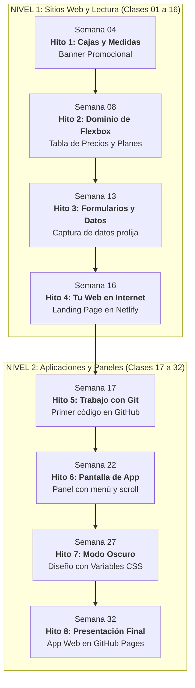

# Plan de Clases: 32 Proyectos para Aprender Diseño Web

> **Trayecto Anual de Diseño Web por Proyectos (Nivel 1 y Nivel 2)**  
> 32 semanas · 1 clase semanal de 3 horas (180 min) · Cero teoría de memoria · Proyectos reales desde el primer día

---

## Índice

1. [Cómo vamos a trabajar en cada clase](#1-cómo-vamos-a-trabajar-en-cada-clase)
2. [Nivel 1: Páginas Web y Sitios de Lectura (Clases 01 a 16)](#2-nivel-1-páginas-web-y-sitios-de-lectura-clases-01-a-16)
3. [Nivel 2: Pantallas de Aplicaciones, Paneles y Sistemas de Diseño (Clases 17 a 32)](#3-nivel-2-pantallas-de-aplicaciones-paneles-y-sistemas-de-diseño-clases-17-a-32)
4. [Hitos y Proyectos Clave del Año](#4-hitos-y-proyectos-clave-del-año)

---

## 1. Cómo vamos a trabajar en cada clase

En este curso no vas a escuchar presentaciones teóricas aburridas ni vas a memorizar etiquetas de memoria. Cada clase arranca con una pantalla real terminada que desarmamos juntos para entender cómo está hecha, y luego la construís con tus propias manos.

* **Boceto rápido en cajas (5 minutos):** Antes de tocar el teclado, dibujamos la estructura en rectángulos simples con herramientas online gratuitas como [Excalidraw](https://excalidraw.com) o en papel. Si podés dibujarlo como cajas organizadas, lo podés maquetar en código.
* **Elegí tu nivel de ayuda:** En cada clase vos decidís cómo querés arrancar:
  * **Modo Guiado:** Una carpeta base que ya trae la estructura armada y comentarios claros que te indican dónde escribir tu código. Ideal para avanzar con paso firme y sin trabarte.
  * **Modo Autónomo:** Para quienes quieran desafiarse: solo te damos el texto crudo y la imagen de referencia para que crees tus archivos desde cero.
* **JavaScript simple para dar vida a la página:** Cuando una interfaz necesita movimiento (abrir un menú en el celular, mostrar u ocultar una contraseña o prender el modo oscuro), usamos un patrón simple y transparente de solo 3 pasos para conectar el clic del usuario con los estilos de CSS.
* **Estilos profesionales:** Usamos combinaciones cuidadas de tipografía, colores y espaciados para que tus páginas se vean como productos reales de internet y no como ejercicios escolares.
* **Práctica opcional para la semana:** Cada clase incluye un pequeño reto de 20 minutos para que quien tenga ganas de seguir practicando en su casa pueda sumar un componente extra a su ritmo.

---

## 2. Nivel 1: Páginas Web y Sitios de Lectura (Clases 01 a 16)

> **La idea central de este nivel:** Páginas web que se leen hacia abajo con scroll natural, cuidando la tipografía, el orden del contenido y la adaptación a celulares.  
> **Herramientas:** Visual Studio Code, Live Server y publicación directa en internet con **Netlify Drop**.

| # | Proyecto que construimos | El problema que resolvemos | Lo que aprendemos de HTML y CSS | Estilo visual sugerido | Interactividad |
|---|---|---|---|---|:---:|
| **01** | **Tarjeta de Perfil Personal (Link in Bio)** | La web por defecto muestra texto plano negro y enlaces azules desordenados. | Estructura básica de un archivo web (`html`, `head`, `body`), textos, enlaces e imágenes con descripción. Tu primer archivo de estilos `style.css`. | Neo-Brutalismo Suave | No |
| **02** | **Ficha de Receta Culinaria** | El texto corrido sin jerarquías cansa la vista y nadie lo lee. | Etiquetas con significado (`header`, `main`, `article`, listas con viñetas y numeradas). Fuentes, tamaños, interlineado y colores para que dé gusto leer. | Editorial Cálido | No |
| **03** | **Tarjeta de Producto E-Commerce** | Las fotos y los textos se pegan a los bordes de la tarjeta o se salen de la caja. | **El Modelo de Caja:** Ancho, alto, relleno interior (`padding`), bordes y separación exterior (`margin`). Cómo evitar desbordes. | SaaS Moderno | No |
| **04** | **Banner Promocional con Fondo** | Cuando agregás espacio adentro de una caja, se ensancha de más y rompe el diseño. | La regla de oro `box-sizing: border-box` para que las medidas sean exactas. Fondos con color e imágenes completas (`background-size: cover`). | Neo-Brutalismo Suave | No |
| **05** | **Artículo de Blog con Citas Destacadas** | Líneas de texto eternas de punta a punta de la pantalla que cansan los ojos. | Tipografías modernas de Google Fonts, tamaño de texto en `rem` y límite de ancho centrado en la pantalla para una lectura cómoda. | Editorial Cálido | No |
| **06** | **Barra de Navegación (Menú Superior)** | Queremos poner el logo a la izquierda y los botones a la derecha sin que se desacomoden. | **Flexbox básico:** Poner elementos en fila horizontal (`display: flex`) y distribuirlos a los extremos con `justify-content: space-between`. | SaaS Moderno | No |
| **07** | **Botonera y Barra de Acciones** | Los iconos y los textos dentro del mismo botón quedan chuecos y desalineados verticalmente. | Centrado vertical perfecto con `align-items: center` y separación limpia entre botones con `gap`. Efectos al pasar el mouse (`:hover`). | Industrial / Fintech | No |
| **08** | **Tabla de Precios y Planes** | Tres tarjetas en fila donde una tiene más texto que otra, quedan de distintas alturas y los botones flotan a cualquier nivel. | Repartir el ancho en partes iguales (`flex: 1`), igualar alturas automáticamente y clavar los botones abajo de todo con `margin-top: auto`. | SaaS Moderno | Botón para alternar precios mensuales y anuales |
| **09** | **Galería de Trabajos (Portfolio)** | Al achicar la pantalla, las tarjetas se aprietan infinitamente hasta deformarse. | Hacer que las tarjetas bajen a la siguiente fila de forma natural con `flex-wrap: wrap` y anchos en porcentaje. | Neo-Brutalismo Suave | No |
| **10** | **Catálogo de Productos con Filtros** | Organizar una columna fija de filtros a la izquierda y una grilla de productos a la derecha. | Combinar cajas Flexbox dentro de otras cajas (menú lateral + grilla de productos). | SaaS Moderno | No |
| **11** | **Formulario de Registro y Contacto** | Los casilleros para escribir quedan desalineados y el usuario no sabe dónde hacer clic. | Formularios prolijos: casilleros de texto, email y contraseñas, etiquetas asociadas para hacer clic en el texto, y resaltado del campo activo (`:focus`). | SaaS Moderno | Botón para mostrar u ocultar la contraseña escrita |
| **12** | **Formulario de Cotización o Reservas** | Opciones de selección múltiple, desplegables y áreas de mensaje desordenadas. | Menús desplegables (`select`), casillas de verificación (`checkbox`), botones de opción única (`radio`) y cajas de comentarios (`textarea`). | Editorial Cálido | No |
| **13** | **Tabla de Posiciones o Comparativa** | Datos numéricos y listas de datos desalineadas y difíciles de comparar. | Tablas semánticas (`table`, `tr`, `th`, `td`), unión de bordes (`border-collapse`) y alineación de números a la derecha para comparar fácil. | Industrial / Fintech | No |
| **14** | **Página Completa de Producto (Parte 1)** | Unir todo lo aprendido en una sola página larga y profesional (Menú, Portada, Características, Precios y Pie de página). | Armado de la estructura completa del sitio, enlaces que scrollean suavemente a cada sección y preguntas frecuentes con acordeón nativo (`details`). | A tu elección | No |
| **15** | **Página Completa de Producto (Parte 2)** | En la pantalla chica del celular el menú tapa toda la página y necesita abrirse con un botón. | Adaptar la página a celulares (Media Queries). Conectar el botón de tres rayitas (hamburguesa) para abrir y cerrar el menú móvil. | A tu elección | Abrir y cerrar el menú en celulares |
| **16** | **Tu Primera Web en Internet y Auditoría** | La página solo funciona en tu computadora y querés compartirla con amigos o clientes. | Revisar que no haya errores de código, verificar que cargue rápido y subir la carpeta a internet gratis con **Netlify Drop** para tener tu enlace público. | Libre | No |

---

## 3. Nivel 2: Pantallas de Aplicaciones, Paneles y Sistemas de Diseño (Clases 17 a 32)

> **La idea central de este nivel:** Ya no armamos páginas de lectura, sino **pantallas de aplicaciones interactivas** (estilo Spotify, Gmail o paneles de control), con control de versiones profesional en Git y adaptación perfecta a celulares y computadoras.  
> **Herramientas:** Terminal de VS Code, **Git y GitHub**, y publicación automática en **GitHub Pages**.

| # | Proyecto que construimos | El problema que resolvemos | Lo que aprendemos de HTML y CSS | Estilo visual sugerido | Interactividad |
|---|---|---|---|---|:---:|
| **17** | **Guardá tu código como un profesional (Git)** | Modificar código sin copia de seguridad hace que un error borre horas de trabajo. | Tu primer repositorio con Git en la terminal de VS Code: guardar cambios (`commit`), crear tu cuenta en GitHub y subir tu proyecto a la nube (`push`). | Industrial / Fintech | No |
| **18** | **Tarjeta con Notificación Flotante (Badge)** | Queremos colocar un circulito de "Nuevo" o "3 mensajes" en la esquina de una tarjeta sin que corra los textos. | **Posicionamiento:** Sacar elementos del flujo normal con `position: absolute` y fijar la referencia en la tarjeta con `position: relative`. | SaaS Moderno | No |
| **19** | **Menú Superior Fijo con Notificaciones** | El menú desaparece al scrollear hacia abajo y una ventanita flotante queda tapada por otros elementos. | Dejar el menú pegado arriba al hacer scroll (`position: sticky`), y controlar qué elemento queda arriba de cuál con capas (`z-index`). | Industrial / Fintech | Abrir y cerrar la ventanita de notificaciones |
| **20** | **Mosaico de Fotos y Portfolio Creativo** | Flexbox solo piensa en filas o columnas separadas; no permite armar mosaicos con huecos y fotos de distintos tamaños. | **CSS Grid:** El motor para diseñar en dos dimensiones al mismo tiempo (filas y columnas juntas), usando fracciones (`fr`) y separaciones (`gap`). | Neo-Brutalismo Suave | No |
| **21** | **Grilla Estilo Bento (Apple / Linear)** | Tarjetas modernas donde una es grande y ocupa dos columnas y dos filas, mientras otras son pequeñas, sin romper la cuadrícula. | Expandir tarjetas en la grilla (`grid-column: span 2` y `grid-row: span 2`) para armar composiciones asimétricas y dinámicas. | SaaS Moderno | No |
| **22** | **Estructura Base de una App (App Shell)** | Queremos una pantalla fija de aplicación (estilo panel de control) donde el menú lateral quede quieto y solo scrollee el contenido central. | Dividir la pantalla en áreas nombradas (`grid-template-areas`), usar la altura real de la pantalla (`100dvh`) y scroll independiente en el panel de trabajo. | Industrial / Fintech | No |
| **23** | **Panel de Métricas (Dashboard de Control)** | Cómo coordinar el esqueleto general de la aplicación con los detalles chicos dentro de cada tarjeta de estadística. | **La combinación profesional:** CSS Grid para el esqueleto de la pantalla y Flexbox para los detalles internos de cada tarjeta (iconos, números y porcentajes). | Industrial / Fintech | No |
| **24** | **Grillas que se acomodan solas a cualquier pantalla** | Tener que escribir reglas manuales para cada tamaño de celular, tablet o monitor es agotador y frágil. | Columnas automáticas e inteligentes con `repeat()`, `minmax()` y `auto-fit`: la grilla se acomoda sola sin escribir una sola media query. | SaaS Moderno | No |
| **25** | **Menú Lateral Deslizable para Celulares** | En la pantalla chica del celular, la barra lateral ocupa demasiado espacio y tapa el contenido del usuario. | Pensar primero en el celular (*Mobile-First*): la barra lateral arranca oculta y se desliza suavemente sobre la pantalla al tocar un botón. | SaaS Moderno | Abrir y cerrar el menú lateral en celulares |
| **26** | **Sistema de Colores y Estilos (Design Tokens)** | Cambiar el color de tu marca o redondear los bordes te obliga a buscar y reemplazar en cientos de líneas de código. | **Variables de CSS (`:root`):** Definir tu paleta de colores, fuentes y radios de borde en un solo lugar central para cambiar el diseño entero en 2 segundos. | Libre | No |
| **27** | **Modo Oscuro (Dark Mode)** | Tus usuarios quieren usar la app de noche sin quemarse los ojos, pero duplicar el código CSS es inviable. | Alternar entre tema claro y oscuro cambiando solo las variables de color. Conectar un botón que recuerde la elección del usuario en su navegador. | Industrial / Fintech | Botón de modo claro / modo oscuro con memoria |
| **28** | **Iconos Nítidos (SVG) y Video Nativo** | Las imágenes PNG de iconos se ven borrosas al agrandarlas y no cambian de color con el texto. | Incorporar iconos vectoriales modernos (**Tabler Icons**) que adoptan el color del texto automáticamente. Agregar reproductores de video y audio nativos. | Editorial Cálido | No |
| **29** | **Formulario con Avisos Visuales en Vivo** | El usuario escribe mal un correo o deja un campo vacío y no se entera hasta que la página falla. | Casilleros modernos (calendario, selector de color, control deslizante) y bordes que se ponen en verde o rojo automáticamente mientras escribís (`:valid` y `:invalid`). | SaaS Moderno | No |
| **30** | **Factura Comercial Lista para Imprimir o Guardar en PDF** | Al querer imprimir un comprobante o factura (`Ctrl + P`), sale el menú de la web, se cortan las tablas y se gasta tinta al cohete. | Estilos especiales de impresión (`@media print`): ocultar menús, forzar colores de fondo limpios y evitar que las tablas se corten entre dos hojas. | Editorial Cálido | No |
| **31** | **Proyecto Final: Tu Propia Aplicación Web Completa** | Ensamblar todas las habilidades del año en una aplicación web terminada: panel de métricas, menú lateral, modo oscuro y ventana modal. | Arquitectura limpia de archivos, accesibilidad para navegar con el teclado y componentes interactivos integrados con solidez. | A tu elección | Ventana emergente (modal) para crear registros |
| **32** | **Publicación Automática en GitHub Pages y Cierre** | Tu aplicación tiene que estar online y actualizarse automáticamente cada vez que hacés un cambio en tu código. | Configuración de publicación automática en **GitHub Pages**, revisión final de rendimiento y accesibilidad con Lighthouse, y presentación de proyectos. | Libre | No |

---

## 4. Hitos y Proyectos Clave del Año

A lo largo de las 32 semanas vas a ir alcanzando 8 hitos concretos con proyectos terminados para sumar a tu portfolio personal:

| Semana | Nivel | Hito que alcanzás | Qué te llevás funcionando | Cómo sabemos que está bien |
| :---: | :---: | :--- | :--- | :--- |
| **04** | 1 | **Hito 1: Control del espacio y cajas** | Banner promocional con fondo | Las medidas son exactas, no hay desbordes y entendés cómo funciona el relleno y los márgenes. |
| **08** | 1 | **Hito 2: Alineación horizontal profesional** | Tabla de 3 planes de precios | Las tres tarjetas tienen exactamente la misma altura y los botones quedan alineados en la misma línea. |
| **13** | 1 | **Hito 3: Formularios y tablas limpias** | Formulario accesible y tabla ordenada | Se puede hacer clic en los textos para activar los casilleros y los números de la tabla se comparan fácil. |
| **16** | 1 | **Hito 4: Cierre del Nivel 1** | Página completa de producto | Tu sitio está publicado con un enlace real en **Netlify Drop** y se lee perfecto en celular y computadora. |
| **17** | 2 | **Hito 5: Guardado profesional en la nube** | Tarjeta de métricas versionada | Sabés guardar cambios desde la terminal y tu código está a salvo en tu cuenta de GitHub. |
| **22** | 2 | **Hito 6: Pantalla de aplicación fija** | Panel con barra lateral y contenido | El menú queda fijo, no hay saltos raros en celulares y solo scrollea el área de trabajo. |
| **27** | 2 | **Hito 7: Sistema de estilos y Modo Oscuro** | Panel interactivo claro / oscuro | Cambiás toda la estética de la app tocando un solo archivo y el botón recuerda el tema elegido. |
| **32** | 2 | **Hito 8: Proyecto Integrador Final** | Aplicación web completa online | Tu proyecto final está publicado en **GitHub Pages**, carga rápido, funciona en celulares y está listo para mostrar. |
